# Escape Singularity: a case study

A 2D space game about one decision, built with a team of AI agents. **[Play it](https://adarshkhera.github.io/escape-singularity/)** · **[Code](https://github.com/AdarshKhera/escape-singularity)**

*Still in progress. I'll keep updating this page and its screenshots as the game changes.*

## What it is

You fly a small ship toward a black hole. It pulls you off course. Turn away too late and it swallows you. Turn away too early and you fly into the debris you were avoiding. Escape it, and the next, bigger one is waiting.

The whole game is that one timing call: **when do I commit?** Everything else (planets, rockets, fuel, hazards) exists to make that call harder or more interesting.

## How I work it out

I start with the rule in plain words, then the picture, then a playable build, and I change my mind a lot in that order. For this game that meant describing the mechanic as a single paragraph ("you have about ten seconds, steer up or down by your own estimate, steer too early and you hit rocks, too late and you're sucked in"), then supplying a reference photo of a real black hole, then offering to draw it to scale. Then I played every build and reacted to what I felt, not what I'd planned.

<!-- ADD HERE: whiteboard photos. The lane and the two escape arcs. The "20x bigger than a planet" scale sketch. The level ladder. -->

The rules I held the design to:

- **One input that matters.** Steer up or down. Thrust, brake and boost only change how much time you have.
- **Fuel is the clock.** Steering and thrusting burn it, nothing refills it. That is what stops you from just holding the turn forever.
- **The hole is never the obstacle you dodge.** You can't steer around it, you can only choose how you slip past it.
- **Every level adds one thing.** No level may ask the player to learn two new ideas at once.

## From 3D to 2D, in a day

My first brief was a 3D game: a first-person view like SkyRoads, a real shader black hole with gravitational lensing and a Doppler-brightened disk, ten levels. I rewrote it within the hour. It would have cost a lot of build time and tokens before I knew whether the mechanic was fun at all. The first 3D attempt also simply looked amateurish.

So I flipped it to a side-scroller in the spirit of Contra and Jetpack Joyride: left to right, steer up and down, a huge slow threat ahead. The mechanic survived the whole change untouched, which told me it was the right thing to prove first. About two days of building later, the game is where you see it now.

## The physics

I kept it simple on purpose and tuned it by feel and by simulation.

- **The black hole's pull is not gravity.** Real inverse-square gravity makes escape impossible once you are close, which is accurate and unplayable. Instead the pull is a capped drag toward the centreline that peaks exactly as you draw level with the hole. Climbing away never buys relief. You have to hold the turn all the way through.
- **Planets are real gravity.** Pull falls with the square of distance, scaled by surface gravity from real values. Bigger worlds are heavier and reach further, so Jupiter is genuinely harder to leave than Mercury. A clean skim earns a slingshot of speed.
- **Steering always beats a planet.** Every planet's pull stays below the ship's steering strength one radius off its surface, so a planet can bend your line but never trap a pilot who steers.
- **The ship must never leave the screen.** This rule broke three times, each time because a new camera effect (a zoom for drama, a boost zoom, a push-in at the hole) made things bigger without checking the rule. It is now a hard ceiling on camera scale, covered by a test.
- **Every level must be beatable.** A headless simulation flies each level above and below the hole with every ship, using the real physics functions, and fails the build if one can't be cleared.

## The black hole, four versions

The hole is the star, so it changed the most.

| | |
|---|---|
| 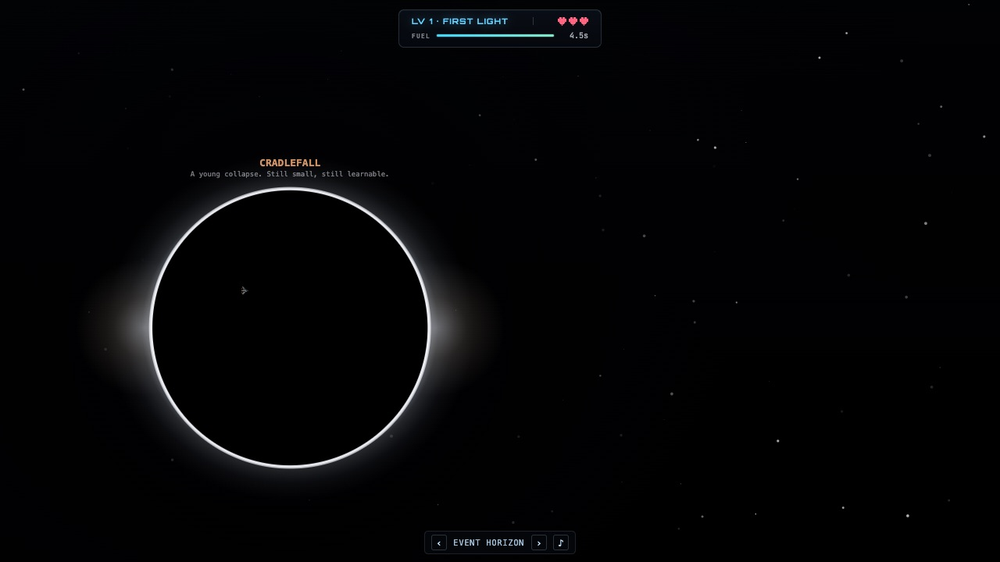 | **Version 1: a glowing ring.** The first 2D hole was a black disc with a thin bright ring, drawn to a reference photograph. It looked flat, and it slid in from the edge of the screen already enormous. |
| 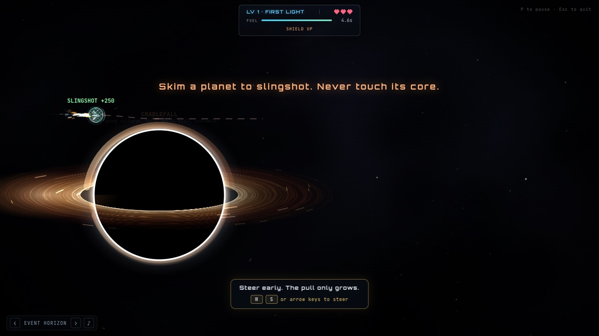 | **Version 2: an accretion disk.** I added a spinning, edge-on disk, brighter on the side moving toward you, with matter spiralling in. Much better to look at, but it still arrived huge and filled the frame at once. |
| 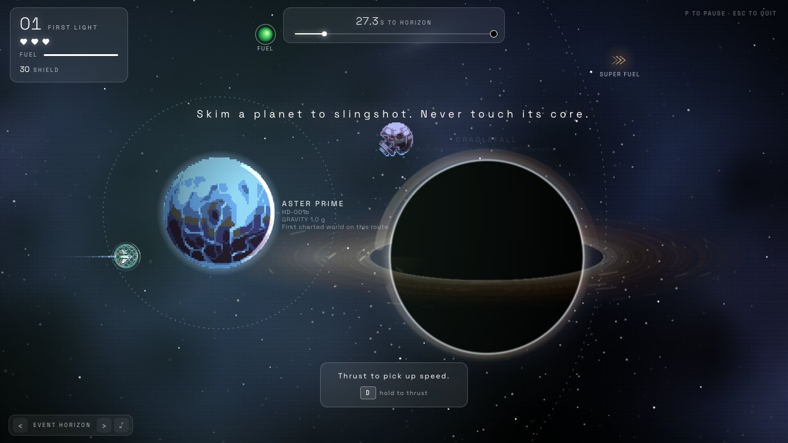 | **Version 3: seen from far away.** The key change was to treat it like perspective. A distant hole is now a small, dim, slightly soft disc on the horizon, so it stays in the background and the path stays the focus. |
| 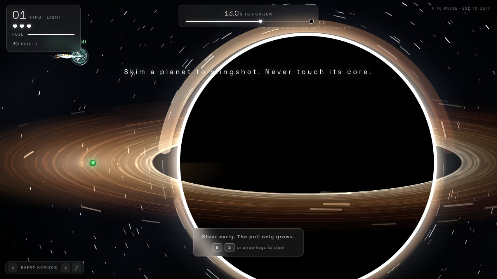 | **...then it swells.** Its apparent size goes as one over the remaining distance, so it grows slowly, then faster and faster. |
|  | **...until it is vast.** At the committed turn its rim is a huge arc across the lower or upper half of the screen and the ship is a speck beside it. The camera follows the turn, the sky bends around the rim, and space gets darker instead of glowing. |
| 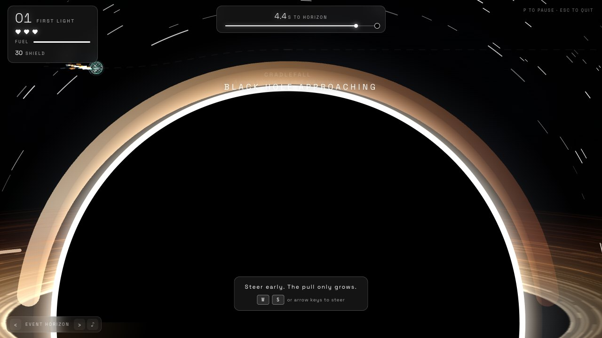 | **The turn itself.** Closest approach, still readable: you can see exactly where the capture edge is. |

Along the way I also gave each hole its own colour, so you can tell them apart across the 18 holes in the game.

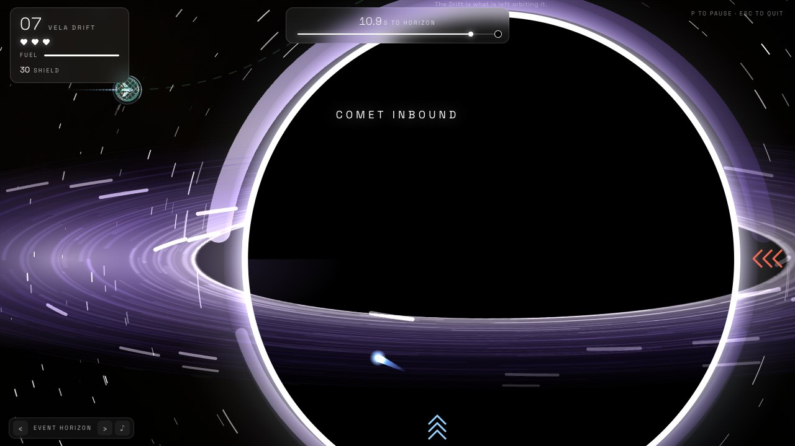

## The levels

Twelve levels, one new idea each, so the difficulty climbs without ever asking the player to learn two things at once.

| # | Level | New idea |
|---|---|---|
| 1 | First Light | Learn the turn. Skim a planet to slingshot |
| 2 | Kepler Drift | Asteroids drift into your lane |
| 3 | Ashfall Run | Rockets. Fire to clear a blockade |
| 4 | Sol System: Inner Worlds | Spinning derelicts. Time your pass |
| 5 | Sol System: Outer Worlds | Meteor showers. Find the gap |
| 6 | Cygnus Reach | A solid rock belt. Crack it open with rockets |
| 7 | Vela Drift | Comets cross your lane |
| 8 | Orion's Rim | A second, bigger hole past the first |
| 9 | Perseus Fault | Ion storms sap steering and fuel |
| 10 | The Maw | Gravity wells pulse. Cross while they are dark |
| 11 | Wanderer's Reach | Rogue planets wander. Read their swing |
| 12 | Singularity | Three horizons, everything at once |

Levels 4 and 5 are the real solar system, in order, with real relative sizes, surface gravities and colours, and the Sun as the black hole it became. Everywhere else the worlds are invented.

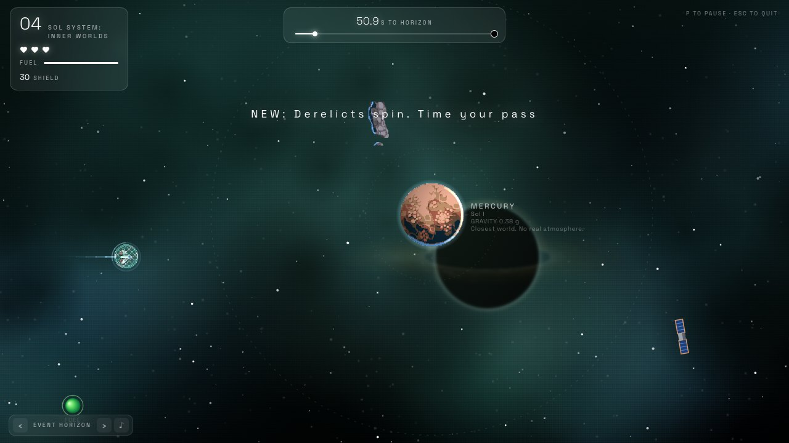
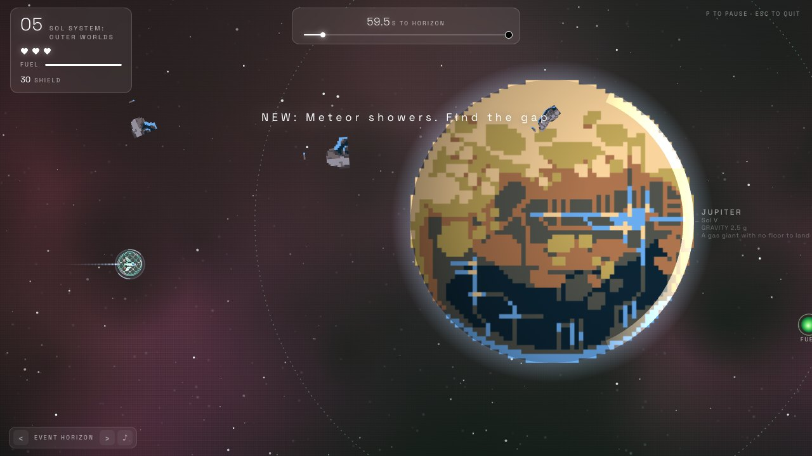
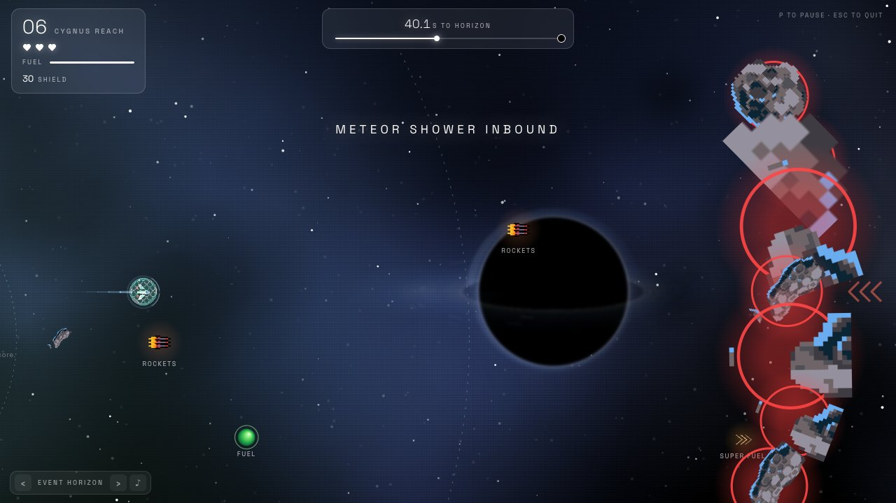
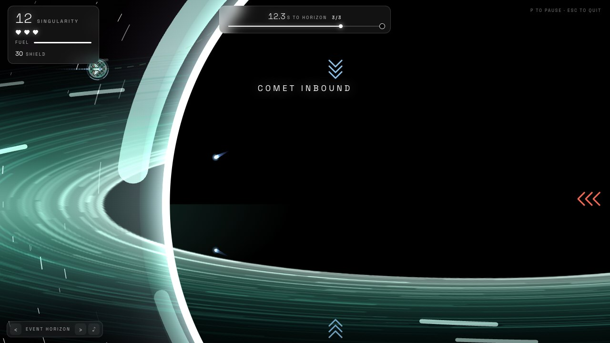

Each level also teaches its new idea gently: a short banner when it first appears, and on the early levels a coach mark that waits for you to try the action.

## Look and feel

The interface had three passes. The first was blue-black and retro. The second was graphite grays with a neon cyan accent, which was cleaner but still looked like a game jam entry. For the third I used slowroads.io as the reference for how calm a game interface can be: frosted glass instead of boxes, small wide-spaced capital letters for labels, thin numerals, and one colour. I kept what I loved about the old HUD, the progress line to the next hole and the row of hearts, and changed everything about how they look.

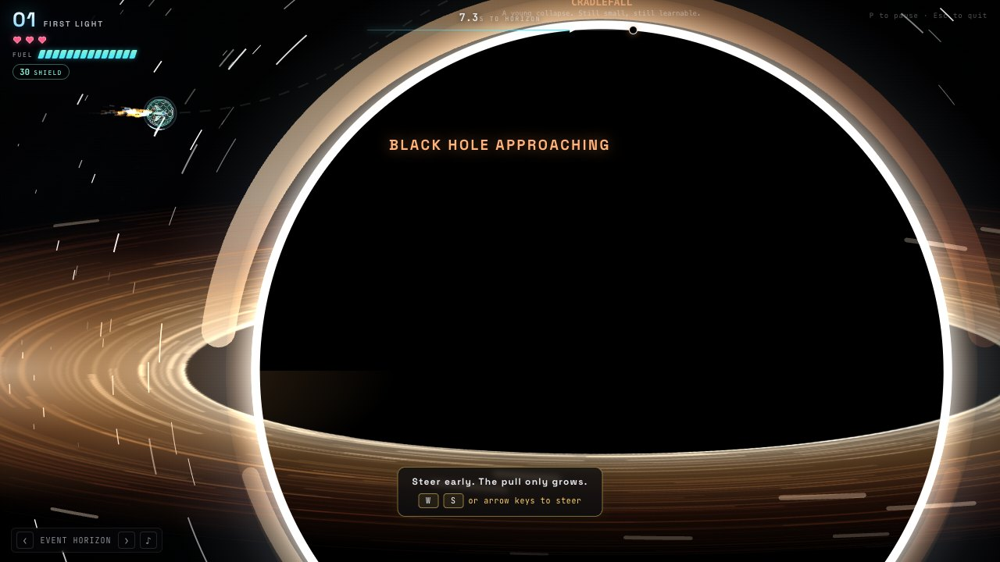
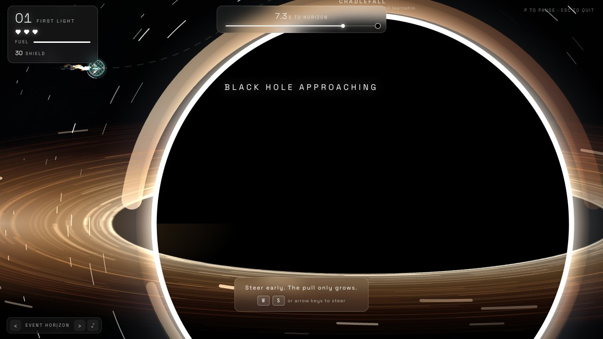

The HUD is still only four things: the level number and name, your lives, a fuel bar, and a slim track showing how far you are from the next hole. Rockets and shield show up only while you hold them. The labels drawn on the game itself (planets, the black hole's name, pickups) use the same type, so nothing looks pasted on. Anything that needs more room (ships, records, settings) lives in menus instead of on screen during play.

The menus have not had this pass yet. They still carry the older graphite and cyan look, and the same treatment is next.

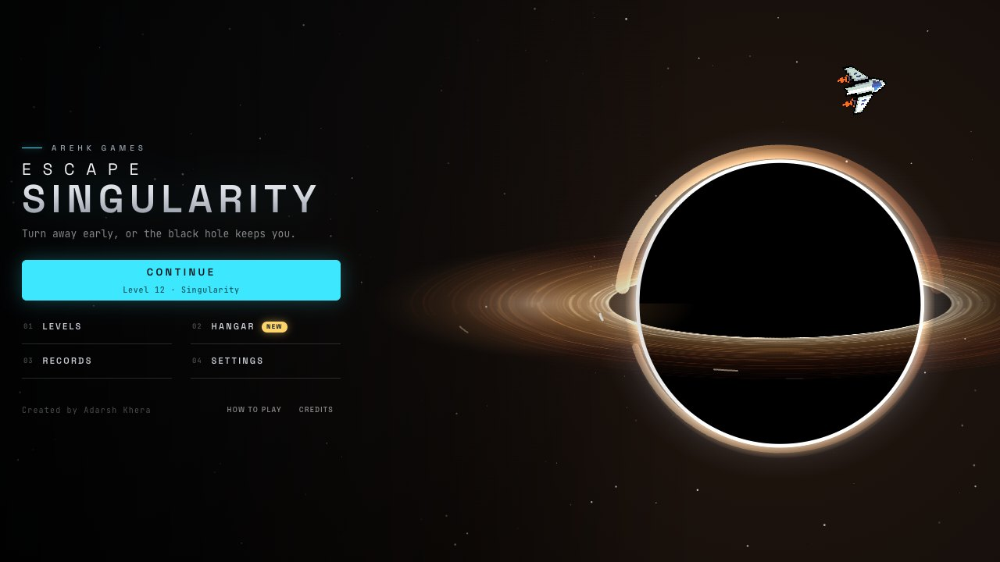
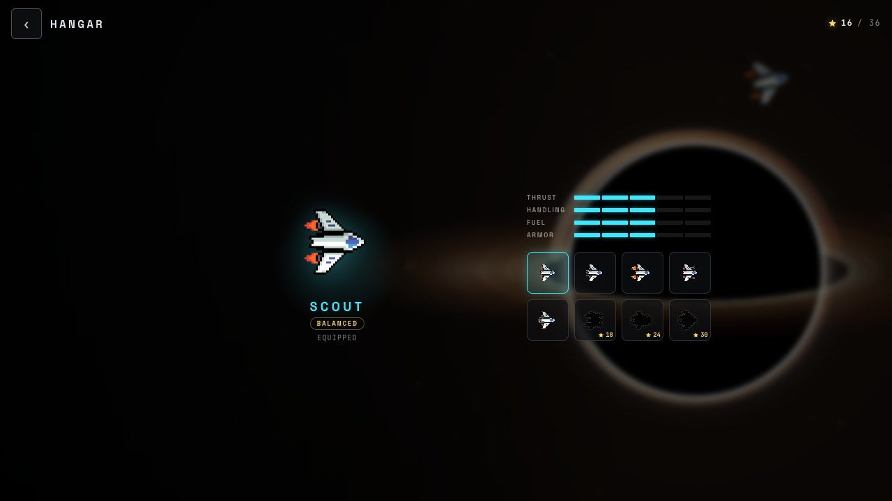
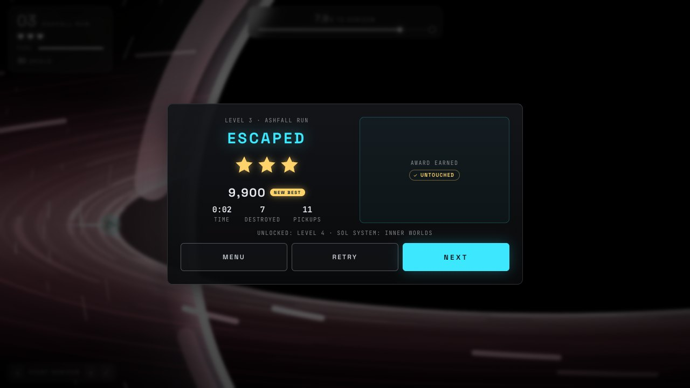

The game also runs on a phone in landscape, with a steer pad and thrust, brake and fire buttons, saved progress, and eight ships that trade speed against handling, fuel and armour.

## How it's built

React, TypeScript, Zustand and a single Canvas 2D loop, all in a Vite app on GitHub Pages. I write the brief and review what ships. A small team of AI agents (Claude Code) builds it, with some agents working in parallel on separate branches and another reviewing the result. About 200 unit tests cover the physics, the camera rule, level layout and scoring.

## What I would change

The earliest versions are the clearest evidence of what to do differently: I let the black hole be a visual stunt before it was a piece of timing. Version 3 only worked once I treated its size as information. The farther it is, the smaller and quieter it should be.

## Credits

Ship, rocket and shield art: *Void - Main Ship* by Baldur, distributed by [Foozle](https://www.foozle.io) (CC0). Planets, moons and asteroids: *Free Celestial Objects Pixel Art Pack* by norma_2d, used under its licence (free to use in projects, not for redistribution, credit appreciated). Fonts: Space Grotesk and JetBrains Mono (SIL OFL). Music and sound effects are original and synthesised in the browser. Code under MIT; art keeps its own licence. Full details in the [README](../README.md).

## Still in progress

This is not finished. Next up: a redesign of the secondary menus, more levels and hazards, tuning the difficulty, and real-device testing for touch and fullscreen. I'll update this page, and its screenshots, whenever the interface changes.
